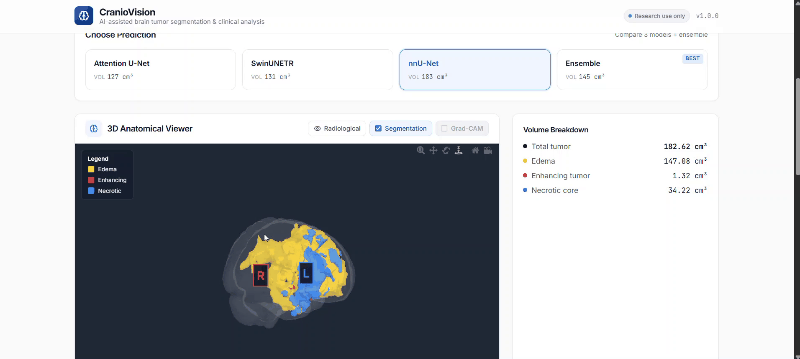

<div align="center">

# CranioVision

**AI-Assisted Clinical Platform for 3D Brain Tumor Segmentation, Anatomical Analysis, and Explainable Volumetric Analysis**

[](https://www.python.org/)
[](https://pytorch.org/)
[](https://monai.io/)
[](https://fastapi.tiangolo.com/)
[](https://nextjs.org/)
[](#license)
[](https://www.synapse.org/brats2024)
[]()

[Demo](#demo) · [**Setup & Run**](#running-the-system) · [Capabilities](#core-capabilities) · [Results](#final-results) · [Architecture](#architecture) · [Design Decisions](#design-decisions)

</div>

---

CranioVision is an end-to-end clinical platform that takes multi-modal brain MRI volumes (T1, T1c, T2, FLAIR) and produces **clinically interpretable** tumor segmentations from four independent prediction sources, three deep learning models plus a consensus ensemble, letting the radiologist choose which output to trust. Each prediction is paired with anatomical context (Harvard-Oxford atlas), eloquent cortex proximity analysis, model attention heatmaps via Grad-CAM, and per-region tumor volumes in cm³.

The project addresses a real gap in clinical tooling. Commercial systems like BrainLab and iPlan are prohibitively expensive. Open research prototypes such as DSNet and TumorPrism3D stop at single-model inference. CranioVision is the first accessible, open platform combining automated 3D tumor segmentation with multi-model second-opinion logic, atlas-based anatomical reasoning, surgical risk analysis, and Grad-CAM explainability in one deployable system.

---

## Demo

[](assets/demo.mp4)

https://github.com/user-attachments/assets/5bd59055-36f9-4f7d-a35e-44a9899f52cf

The demo walks through the full clinical workflow: drag-and-drop a BraTS case, watch the pipeline run all three models plus ensemble plus atlas analysis, explore the rotatable 3D brain mesh viewer, switch between model predictions, generate Grad-CAM explanations, and download the 5-page clinical PDF report.

---

## Running the System

> **You are on `develop`.** This branch carries the complete runnable tree —
> `src/` (ML pipeline), `backend/` (FastAPI), `frontend/` (Next.js), `tests/`.
> `main` is a public showcase of the ML pipeline only and will not run as a
> system. Clone `develop` if you want to bring CranioVision up.

```bash
git clone -b develop https://github.com/DPHeshanRanasinghe/CranioVision.git
cd CranioVision
```

### What is *not* in the repository

Three things the system needs cannot be committed. Get them before you start —
each one fails only at the point of use, not at startup, so a missing asset
looks like a broken feature rather than a missing file.

| Asset | Path | How to get it | Size |
|---|---|---|---|
| Model checkpoints | `models/` | Not public — request from the maintainers, or train your own (see `src/cranovision/training/`) | ~455 MB |
| BraTS 2024 cases | `data/raw/BraTS2024_small_dataset/<CASE_ID>/` | [BraTS 2024 on Synapse](https://www.synapse.org/brats2024) — registration and a data-use agreement are required | ~250 MB/case |
| Atlas templates | `atlas_data/` | `python -m src.cranovision.atlas.download` | ~4 MB |

`models/` must contain exactly these three files, named exactly:

```
models/attention_unet_best.pth
models/swin_unetr_best.pth
models/nnunet_best.pth
```

Each BraTS case folder must contain the four modalities, and optionally the
ground-truth segmentation — supply `-seg` and the UI additionally reports Dice
against it:

```
data/raw/BraTS2024_small_dataset/BraTS-GLI-02062-100/
├── BraTS-GLI-02062-100-t1n.nii     required
├── BraTS-GLI-02062-100-t1c.nii     required
├── BraTS-GLI-02062-100-t2w.nii     required
├── BraTS-GLI-02062-100-t2f.nii     required
└── BraTS-GLI-02062-100-seg.nii     optional — enables "Dice vs GT"
```

Anything you drop in there is picked up automatically: `GET /demo-cases` scans
the folder, so the dropdown in the UI needs no configuration.

### Prerequisites

- **Python 3.11**
- **Node 18+**
- **Docker Desktop** — only for the result cache; the system runs without it,
  just slowly
- A CUDA GPU is optional. Everything runs on CPU; a full analysis is ~9 minutes
  on CPU versus ~2 minutes on a 4 GB GPU.

### First-time setup — from the repo root

```bash
python -m venv .venv
.venv/Scripts/pip install -r requirements.txt
.venv/Scripts/pip install -r backend/requirements.txt
.venv/Scripts/python -m src.cranovision.atlas.download
cd frontend && npm ci && cd ..
```

On Linux/macOS the venv binaries live in `.venv/bin/` rather than
`.venv/Scripts/`.

Two dependencies are easy to miss and produce confusing failures if absent:
`antspyx` (atlas registration — without it you get predictions but no
anatomical labelling and no tumour meshes) and `reportlab` (PDF reports —
without it `POST /jobs/{id}/report` fails). Both are in `requirements.txt`;
`redis` is in `backend/requirements.txt`.

Check the install found your data and device:

```bash
.venv/Scripts/python -m src.cranovision.config
```

### Start it up — three terminals

```bash
cd backend && docker compose up -d
docker compose ps
```

```bash
cd backend
uvicorn main:app --reload --reload-dir . --reload-dir ../src --port 8000
```

```bash
cd frontend && npm run dev
```

Start Redis first so the backend connects to it on boot, and wait for
`docker compose ps` to report **healthy** before starting the backend.

Open <http://localhost:3000>. Confirm the backend found everything:

```bash
curl http://localhost:8000/cache/status
curl http://localhost:8000/demo-cases
```

The first should report `"reachable": true`, the second should list your case
folders.

`--reload-dir ../src` is not optional if you intend to edit the pipeline:
uvicorn watches only its own directory by default, so changes under `src/`
silently have no effect.

### Warm the cache before a demo

A cold analysis is ~9 minutes on CPU; a cached replay is ~3 seconds. Warm every
demo case once, ahead of time:

```bash
cd backend
python scripts/warm_demo_cache.py
```

`--cases <CASE_ID>` warms one case; `--force` re-warms from scratch.

Warm through this script rather than by clicking in the UI: it runs analysis →
Grad-CAM → report in that order, so a case comes out fully warm. A case warmed
without Grad-CAM pays ~150 s the first time someone clicks XAI or Report.

### Cache management

| Goal | Command |
|---|---|
| What is cached | `curl http://localhost:8000/cache/status` |
| Drop all cached cases | `curl -X POST http://localhost:8000/cache/flush` |
| Same, from the container | `docker exec craniovision-cache redis-cli FLUSHALL` |
| Stop the cache, **keep** data | `cd backend && docker compose down` |
| Stop and **destroy** data | `cd backend && docker compose down -v` |
| Run without the cache | `DEMO_CACHE=0 uvicorn main:app --port 8000` |

The cache lives on a named Docker volume, so `docker compose down` — or a
Docker restart — **keeps** your warmed cases. Use `down -v` when you actually
want them gone. Cache keys are a SHA-256 of the input scan bytes, so a renamed
case still hits, and a folder reused with different scans misses rather than
serving the previous patient's result.

**Flush after changing report or pipeline code** — otherwise you will be served
the PDF generated by the old code.

### Running the tests

```bash
.venv/Scripts/python -m pytest tests/ -v
```

The inference tests need the checkpoints present.

### Troubleshooting

| Symptom | Cause | Fix |
|---|---|---|
| `RuntimeError: No model checkpoints found` | `models/` empty | Place the three `.pth` files there, named exactly as above |
| `/demo-cases` returns an empty list | No case folders, or modality files misnamed | Each case folder needs all four `-t1n/-t1c/-t2w/-t2f` volumes |
| `ModuleNotFoundError: ants` / `reportlab` / `redis` | Deps not installed, or only the root requirements were | Re-run both `pip install -r` lines |
| Predictions appear but no anatomy and no 3D tumour | `antspyx` missing, or `atlas_data/` empty | Install `antspyx`; run the atlas download module |
| Report button fails, `OPTIONS ... 400` in the log | Frontend on a port the backend does not allow | Any `localhost` port is accepted now; check nothing else occupies 3000 so you know which port you are on |
| Every run takes ~9 min | Redis unreachable, or case not warmed | Check `/cache/status`; look for `[demo-cache]` lines in the backend log |
| `cache/status` shows `count: 0` after warming | Backend was started before Redis | Restart the backend |
| Job disappears mid-run | `--reload` restarted the server on a file save | Do not edit backend source while a job is running |
| Code changes to `src/cranovision/` have no effect | `--reload` only watches its own directory by default | Start with `--reload-dir . --reload-dir ../src`, or restart the backend |
| Changes still have no effect after restarting | An **orphaned uvicorn worker** is still holding port 8000 and answering requests | List the PIDs listening on 8000; if more than one, kill each and confirm the port is free before starting one server |

---

## Repository layout

```
CranioVision/
├── src/cranovision/     ML pipeline — the part `main` also publishes
│   ├── config.py        Single source of truth: paths, labels, device
│   ├── data/            BraTS scanning/splitting + MONAI transforms
│   ├── models/          Attention U-Net, SwinUNETR, DynUNet factories
│   ├── training/        Train loop and metrics
│   ├── inference/       Prediction, ensemble, Grad-CAM, MC-dropout
│   ├── atlas/           ANTs to MNI152, Harvard-Oxford, eloquent cortex
│   ├── reporting/       Clinical PDF generation
│   ├── analysis/        Research measurement scripts (not in the product path)
│   └── pipeline.py      The orchestrator everything else hangs off
├── backend/             FastAPI server + Redis demo cache  -> backend/README.md
├── frontend/            Next.js dashboard                  -> frontend/README.md
├── research/            Validation study, evidence review, decision log
├── tests/               Pytest suite
├── data/  models/  atlas_data/  outputs/    (untracked — see above)
```

Two design rules in `pipeline.py` are easy to break by accident and worth
knowing before you edit it: Grad-CAM is **always** computed with Attention
U-Net regardless of which prediction is being explained (it is the only one of
the three that produces reliable heatmaps), and atlas analysis is run **per
model**, so each model's anatomical result reflects that model's own prediction
rather than a shared one.

---

## Core Capabilities

| Capability | What It Does | Why It Matters Clinically |
|---|---|---|
| **3-Model Segmentation** | Predicts tumor regions with Attention U-Net, SwinUNETR, and nnU-Net-style DynUNet | Three independent opinions — radiologist sees if models agree |
| **Weighted Ensemble** | Combines all three via Dice-proportional soft voting | Provides a fourth "consensus" prediction with built-in confidence signal |
| **Volume Quantification** | Per-region tumor volume in cm³ with 7.5% mean relative error vs. ground truth | Required for RANO tumor response assessment |
| **Atlas-Based Anatomical Analysis** | ANTs registration to MNI152, Harvard-Oxford lobe and region labeling | Tells the surgeon *where* the tumor is in standardized space |
| **Eloquent Cortex Risk Assessment** | Per-region distance to functional cortex with traffic-light risk classification | Flags surgical risks (motor, speech, vision) before the OR |
| **Grad-CAM XAI** | Shows what the model attends to for each tumor class | Builds clinical trust; validates model is not looking at noise |
| **Multi-Model Agreement Map** | Highlights voxels where all 3 models agree vs. disagree | Direct visual signal of which regions warrant manual review |
| **Interactive 3D WebGL Viewer** | Navigable atlas-space 3D brain mesh with integrated per-class tumors and Grad-CAM heatmaps | Intuitive spatial understanding and presentation-grade demoing |
| **Clinical PDF Report** | Auto-generated 5-page clinical reports with cross-model comparison and anatomical risk analysis | End-to-end delivery of insights to non-technical medical staff |

---

## Final Results

Evaluated on BraTS 2024 small subset: 140 train / 30 val / 30 test cases.

### Per-Model Performance on Test Set (n=30)

| Model | Params | Val Dice | Test Mean Dice | Edema | Enhancing | Necrotic |
|---|---|---|---|---|---|---|
| Attention U-Net | 23.6M | 0.7642 | 0.7308 | 0.858 | 0.676 | 0.658 |
| **SwinUNETR** | 62.2M | 0.8219 | **0.7929** | **0.903** | **0.721** | **0.755** |
| nnU-Net DynUNet | 31.4M | 0.7562 | 0.6925 | 0.845 | 0.560 | 0.672 |
| **Ensemble (3-model)** | — | — | 0.7853 | 0.906 | 0.690 | 0.760 |

SwinUNETR is the strongest single model. The ensemble matches its performance closely (within 1%) and adds an agreement-based confidence signal not available from any single model.

### BraTS Standard Region Dice

| Region | Attention U-Net | SwinUNETR | nnU-Net | Ensemble |
|---|---|---|---|---|
| Whole Tumor (WT) | 0.862 | 0.912 | 0.870 | **0.914** |
| Tumor Core (TC) | 0.711 | 0.810 | 0.745 | 0.806 |
| Enhancing Tumor (ET) | 0.676 | 0.721 | 0.560 | 0.690 |

### Multi-Model Agreement

| Metric | Value |
|---|---|
| Mean unanimous voxel fraction | **99.33%** |
| Minimum unanimous voxel fraction (hardest case) | 98.39% |
| Mean volume relative error vs. ground truth | 7.47% |

The very high agreement across three architecturally diverse models (CNN, Transformer, residual U-Net) is itself a clinically valuable signal. When all three models agree on a voxel, the prediction can be trusted deeply. The 0.7% of voxels where models disagree are typically tumor boundaries — exactly where radiologist review adds the most value.

### Why Four Predictions Are Presented, Not Just the Ensemble

The Dice-weighted ensemble achieves 0.7853 — statistically equivalent to SwinUNETR alone (0.7929). When one model is significantly stronger than its partners, classical ensembling provides minimal Dice gain. **The ensemble's role is therefore not to maximize Dice, but to serve as a consensus signal.** All four predictions (three models + ensemble) are presented in the clinical interface; the radiologist decides which output to trust, with explicit visualization of where they agree and disagree.

---

## Architecture

```
                      MRI input (T1, T1c, T2, FLAIR)
                                    │
                                    ▼
              ┌─────────────────────────────────────────┐
              │        Preprocessing (MONAI)            │
              │  • Orientation → RAS                    │
              │  • Z-score normalization (per-modality) │
              │  • Foreground crop                      │
              └─────────────────────────────────────────┘
                                    │
           ┌────────────────────────┼────────────────────────┐
           ▼                        ▼                        ▼
  ┌────────────────┐      ┌─────────────────┐      ┌────────────────┐
  │ Attention U-Net│      │   SwinUNETR     │      │ nnU-Net-style  │
  │    (23.6M)     │      │    (62.2M)      │      │    (31.4M)     │
  └────────────────┘      └─────────────────┘      └────────────────┘
           │                        │                        │
           └────────────────────────┼────────────────────────┘
                                    ▼
              ┌─────────────────────────────────────────┐
              │   Dice-weighted soft voting (ensemble)  │
              └─────────────────────────────────────────┘
                                    │
       ┌──────────────┬─────────────┼─────────────┬──────────────────┐
       ▼              ▼             ▼             ▼                  ▼
  ┌──────────┐  ┌────────────┐ ┌───────────┐ ┌────────────┐ ┌───────────────┐
  │ Volumes  │  │ ANTs atlas │ │ Eloquent  │ │  Grad-CAM  │ │  Agreement    │
  │  (cm³)   │  │  + anatomy │ │  cortex   │ │ explainer  │ │     map       │
  └──────────┘  └────────────┘ └───────────┘ └────────────┘ └───────────────┘
                                    │
                                    ▼
              Radiologist interface — all 4 predictions shown,
              user selects which to trust per case
```

The frontend provides an interactive experience where radiologists can view these outputs in an exploratory 3D space, toggle Grad-CAM heatmaps directly onto the tumor meshes, and generate offline clinical PDF reports quantifying surgical risk per region.

---

## Models

### Attention U-Net (Oktay et al., 2018)
Standard U-Net with attention gates at each skip connection. The gates suppress irrelevant features (skull, healthy tissue) and emphasize tumor regions. Strong baseline for diffuse structures like edema. High recall on whole tumor.

### SwinUNETR (Hatamizadeh et al., 2022)
Swin Transformer encoder paired with a CNN decoder. The transformer's self-attention captures global context — especially useful for small enhancing-tumor cores that conventional CNNs struggle with. Consistently tops BraTS leaderboards. **Strongest single model in this pipeline.**

### nnU-Net-style DynUNet (Isensee et al., 2021)
Residual-block encoder/decoder with instance normalization. Uses nnU-Net's architectural plan for brain MRI (6-level encoder, filter schedule 32→320, deep supervision). Provides architectural diversity to the ensemble — different inductive biases, different failure modes.

---

## Design Decisions

**Three architecturally diverse models, not three identical ones.** Attention U-Net (CNN with attention gates), SwinUNETR (Transformer encoder), and DynUNet (residual U-Net) make different errors on different cases. This diversity is what makes the agreement signal meaningful — three identical models would always agree.

**Dice-proportional ensemble weights, not equal voting.** Each model's vote is weighted by its validation Dice (SwinUNETR ≈ 0.35, Attention U-Net ≈ 0.33, nnU-Net ≈ 0.32). Equal voting would give the weakest model too much influence.

**Ensemble for confidence, not raw performance.** When one model is significantly stronger than its partners, classical ensembling provides minimal Dice gain. The ensemble's agreement statistic is therefore used as a clinical confidence indicator — when all three models agree on a voxel, that voxel can be trusted; disagreement flags review.

**Atlas-based anatomy in MNI space, not patient native space.** Tumor location is reported in MNI152 standardized coordinates with Harvard-Oxford region labels. This is the universal language of neuroimaging research and enables cross-patient comparison. Patient-native rendering exists for surgical-navigation tools (BrainLab, StealthStation); CranioVision is purposefully a research and second-opinion platform.

**Single shared XAI explainer.** Attention U-Net is the explainer for all four predictions, regardless of which the user is viewing. Empirical analysis showed it produces consistently strong Grad-CAM heatmaps (9-15× signal-to-background ratio), while heatmaps from the other architectures are unreliable. The PDF report explicitly discloses this surrogate-explainer architecture.

**Patch-based Grad-CAM with post-processing.** Full-volume Grad-CAM requires roughly 7 GB of gradient storage. The pipeline locates the tumor via a cheap forward pass, crops a 128³ patch around it, computes Grad-CAM there, and stitches back. Gaussian smoothing, brain masking, and threshold cleanup remove patch-edge artifacts and air-region activations.

**Memory-efficient inference for 4 GB GPUs.** Inference loads one model at a time, saves softmax probabilities to disk, frees GPU memory, and performs final voting on CPU. The full 3-model pipeline runs on a GTX 1650 4 GB without memory pressure.

---

## Tools Used

| Domain | Tool |
|---|---|
| Deep learning | PyTorch 2.5 |
| Medical imaging primitives | MONAI 1.5.2 |
| Volume IO | nibabel, SimpleITK |
| Atlas registration | ANTs (antspyx) |
| Visualization | matplotlib, Plotly (Mesh3d), scikit-image, Three.js |
| Frontend | Next.js 14, React 18, TypeScript, Tailwind CSS |
| Backend | FastAPI, Pydantic, Server-Sent Events |
| Reporting | reportlab |
| Testing | pytest |
| Version control | Git + GitHub (multi-branch workflow) |
| Compute | Local GTX 1650 (dev), Kaggle T4 (training) |

---

## Project Status

| Phase | Description | Status |
|---|---|---|
| **Phase 1** | Foundation + Three-model training | ✅ Complete |
| **Phase 2** | Inference, ensemble, MC Dropout uncertainty, Grad-CAM XAI | ✅ Complete |
| **Phase 3** | ANTs atlas registration, Harvard-Oxford anatomy, eloquent cortex analysis, 5-page clinical PDF | ✅ Complete |
| **Phase 4** | FastAPI backend + Next.js frontend, interactive 3D viewer, deployment-ready | ✅ Complete |

---

## Author

**Heshan Ranasinghe**
Electronic and Telecommunication Engineering
Faculty of Engineering, University of Moratuwa
Sri Lanka

---

## Key References

1. Oktay et al. (2018). *Attention U-Net: Learning Where to Look for the Pancreas.* arXiv:1804.03999
2. Hatamizadeh et al. (2022). *Swin UNETR: Swin Transformers for Semantic Segmentation of Brain Tumors in MRI Images.* arXiv:2201.01266
3. Isensee et al. (2021). *nnU-Net: a self-configuring method for deep learning-based biomedical image segmentation.* Nature Methods 18(2):203-211.
4. Avants et al. (2008). *Symmetric diffeomorphic image registration with cross-correlation: Evaluating automated labeling of elderly and neurodegenerative brain.* Medical Image Analysis 12(1):26-41.
5. Selvaraju et al. (2017). *Grad-CAM: Visual Explanations from Deep Networks via Gradient-based Localization.* ICCV 2017.
6. Desikan et al. (2006). *An automated labeling system for subdividing the human cerebral cortex on MRI scans into gyral based regions of interest.* NeuroImage 31(3):968-980.
7. Baid et al. (2021). *The RSNA-ASNR-MICCAI BraTS 2021 Benchmark on Brain Tumor Segmentation and Radiogenomic Classification.* arXiv:2107.02314.

---

## License

This repository is shared for **academic research and portfolio review purposes**. It is not licensed for clinical deployment, commercial use, or direct redistribution. Clinical deployment requires additional validation, regulatory approval, and a formal licensing arrangement with the author.

For research collaboration or licensing inquiries, please contact the author through institutional channels.
